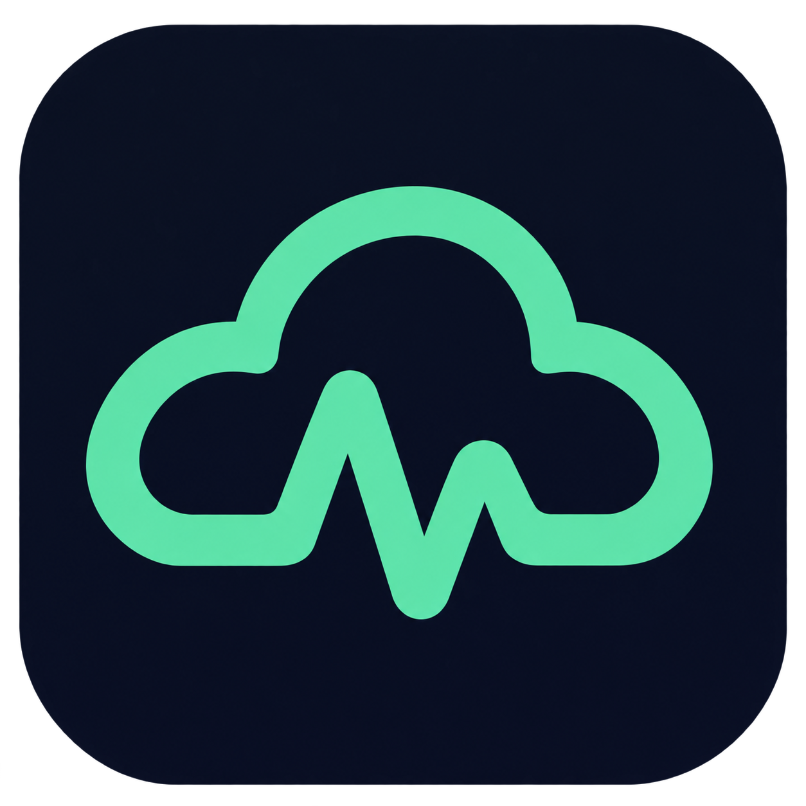
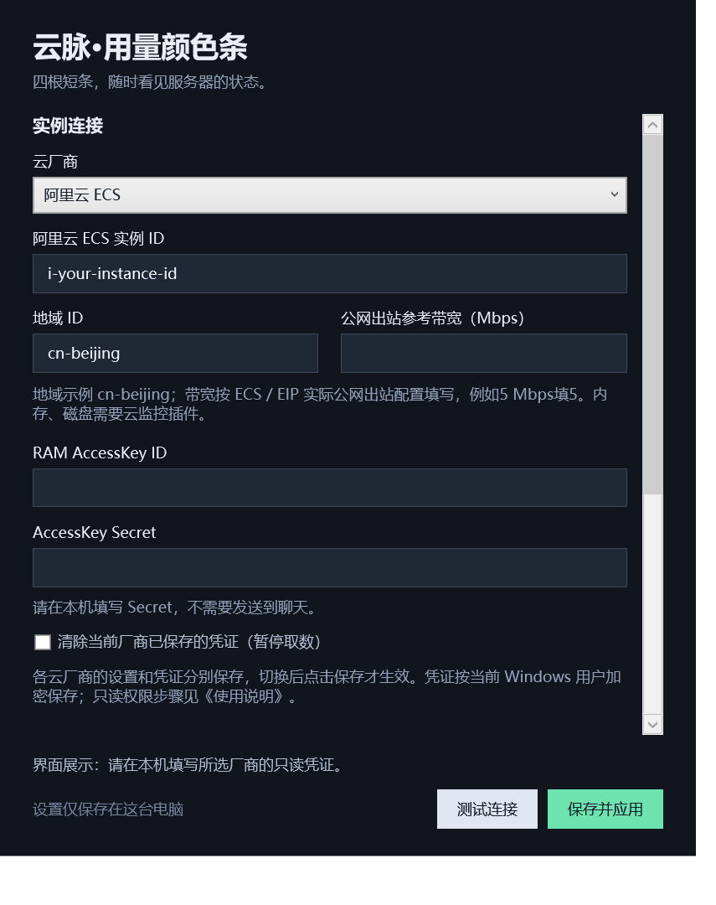

# 云脉·用量颜色条

Windows 10/11 x64 桌面挂件，当前版本 1.1.0。支持阿里云 ECS、腾讯云 CVM、华为云 ECS 和 AWS EC2，每次监控一台实例。四根短条依次显示 CPU、内存、磁盘和出站网络；鼠标悬停查看数值、口径及采样时间。

[下载最新便携版](https://github.com/toggerdemetri-lgtm/cloudpulse-usage-bars/releases/latest)

发行附件只提供**普通便携版、源码和 SHA256 校验文件**，不制作或发布插件版。

## 界面预览

下方颜色条使用演示数值展示颜色和布局，并非实时服务器数据；设置图未填写任何凭证。

| 桌面横条 | 任务栏竖条 |
| --- | --- |
|  |  |

### 设置界面

## 使用与升级

1. 解压便携版 ZIP，在固定目录双击“云脉·用量颜色条.exe”，无需安装 .NET 或管理员权限。
2. 右键颜色条或托盘图标打开设置，选择云厂商，填写该实例的地域、ID及对应只读凭证；华为云另填地域对应项目 ID。
3. 填写 Mbps 带宽，例如5 Mbps填5。阿里云/腾讯云按公网出站配置；华为云/AWS网络含内网流量，填写与监控口径相符的参考上限。
4. 点击“测试连接”，再“保存并应用”。没有上报的指标显示灰色，不用零值替代。测试可逐项显示错误，部分失败不影响其他指标。
5. 各厂商已保存的连接和凭证分别保留；切换后保存才更改实际监控目标。在设置中清除凭证仅清除当前厂商。

从旧版升级会自动按阿里云读取原配置，同一 Windows 用户无需重填已有密钥。先退出旧版再替换程序；软件默认不开机自启，可在设置勾选后保存。请保留程序所在固定路径。

## 厂商与指标差异

| 厂商 | 实例 / 地域示例 | 监控口径 |
| --- | --- | --- |
| 阿里云 ECS | i-… / cn-beijing | 1分钟平均，公网速率；内存和磁盘依赖云监控插件 |
| 腾讯云 CVM | ins-… / ap-beijing | CPU/内存1分钟平均；磁盘为所有盘最高值；公网速率为1分钟最大值 |
| 华为云 ECS | 实例UUID / cn-north-4，加32位项目ID | 基础CPU/网卡总流量5分钟；CES Agent内存/磁盘1分钟 |
| AWS EC2 | i-… / us-east-1；支持中国区 | 基础CPU/网络5分钟，已开详细监控可选1分钟；CWAgent内存/磁盘1分钟 |

每60秒刷新，但不会把5分钟原始数据当成即时数据。1分钟采样超过180秒过期；5分钟采样按完整桶与发布延迟，超过720秒过期。悬停会显示真实周期、时间和错误；旧值带时间，仅供参考。

腾讯云磁盘为平台汇总值，不能固定设备。阿里云可填设备名；华为云填完整 mount_point 维度值；AWS填 path 或 device。默认取各盘最新值中最高的一块，发现磁盘但样本不完整会明确报错。

AWS内存/磁盘当前读取 Linux/macOS 官方 CWAgent 指标，Windows默认性能计数器名称尚未适配；CPU和网络可独立读取。细节见随包各厂商说明。

## 只读凭证配置

密钥只在本机软件填写，不要发送到聊天。Secret留空可保留当前厂商同一密钥ID的已保存Secret；更换ID必须重新填写Secret。临时凭证请填写Token，过期后在本机更新。

- **阿里云**：在 [RAM控制台](https://ram.console.aliyun.com/) 创建专用用户，创建自定义策略，粘贴随附 ram-readonly-policy.json（只含 cms:QueryMetricLast），授权给该用户后创建AccessKey。不需要控制台登录或管理员权限。
- **腾讯云**：在 [CAM控制台](https://console.cloud.tencent.com/cam) 创建专用子用户及API密钥，授予监控只读策略 QcloudMonitorReadOnlyAccess；应用实际只调用 monitor:GetMonitorData。详见 providers-tencent.md。
- **华为云**：从“我的凭证 → 访问密钥”创建AK/SK，在“API凭证”获取实例地域的项目ID；专用IAM用户在对应项目授予 ces:metrics:list、ces:metricData:get 只读权限。详见 providers-huawei.md。
- **AWS**：专用IAM身份只授予 cloudwatch:ListMetrics、cloudwatch:GetMetricStatistics，策略示例及官方Agent配置见 providers-aws.md。中国区使用中国区账户凭证。软件不自动开启详细监控或安装Agent。

具体官方指标、权限及安装文档链接见 providers-tencent.md、providers-huawei.md、providers-aws.md；阿里云接口见 [DescribeMetricLast](https://help.aliyun.com/zh/cms/cloudmonitor-1-0/developer-reference/api-cms-2019-01-01-describemetriclast)。

## 显示与操作

- 低于60%绿色，60%至不足80%黄色，80%以上红色；阈值可在设置修改。缺失、读取失败或过期显示灰色。
- 桌面只显示四根横条，无外围背景；可拖至可用桌面四边，普通窗口会遮住它。
- 拖入任务栏变成四根左右并排的竖条；拖回桌面恢复横条。松手后会重建显示窗口，保留1.0.6已确认有效的显示恢复方案。
- 右键可设置、刷新、锁定、退出；托盘还有“移回桌面”恢复入口。

## 配置与隐私

配置位于当前用户 LocalAppData 下 UsageIsland/settings.json。各厂商密钥和临时Token使用Windows当前用户DPAPI加密，原有加密格式继续兼容；换电脑或Windows用户通常需要重新填写。不要公开整个配置文件。

软件通过官方SDK只读查询云监控，不读取服务器文件，不修改云资源。错误提示不会输出SDK异常正文、签名或密钥。各家API额度、监控和详细监控费用以厂商规则为准。

## 源码与构建

源码采用C# / WPF / .NET 10。运行 build.ps1 可执行核心与SDK离线测试并生成x64自包含程序及源码ZIP；加 -NativeSmoke 可检查实际桌面/任务栏、设置切换和显示窗口生命周期。构建需要 .NET 10 SDK，脚本优先使用项目.tools/dotnet。测试使用临时假配置并自行清理，不加载真实云凭证。

腾讯云、华为云及AWS已完成离线接口/单位/配置测试，尚未使用真实账户进行在线联调。验收范围见“验收记录.md”。

交付后清理生成数据可运行 scripts/Clean-Generated.ps1（加 -Preview 只查看范围）：仅保留最新两份ZIP和校验码，删除历史构建、临时探针与测试脚手架；保留源码、测试源码及构建SDK/依赖，不访问用户实际配置。
